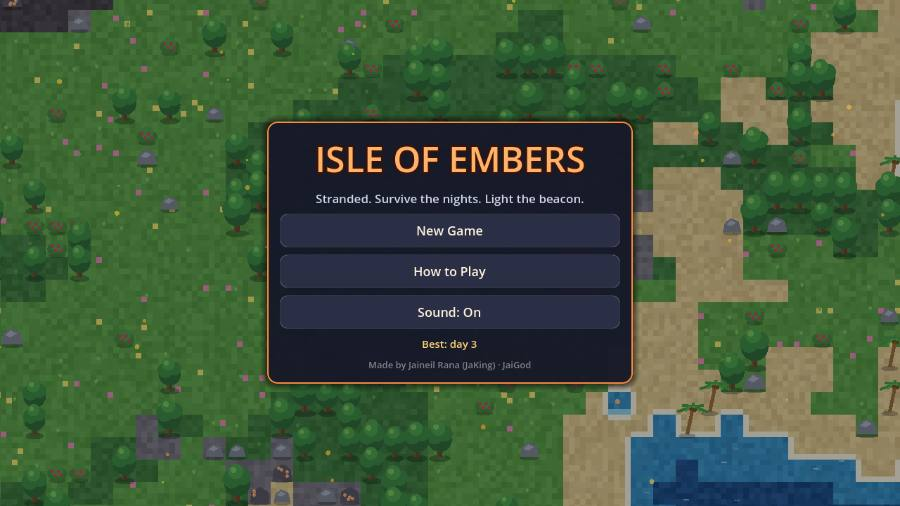
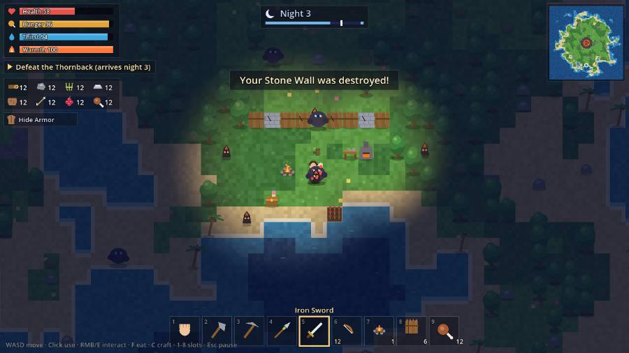
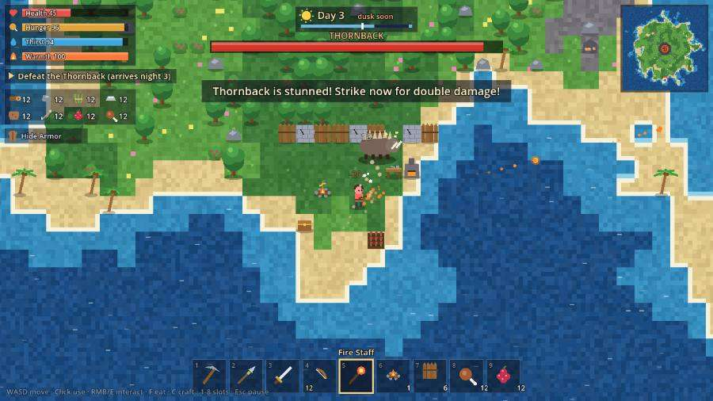
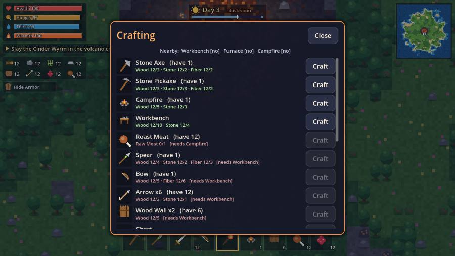
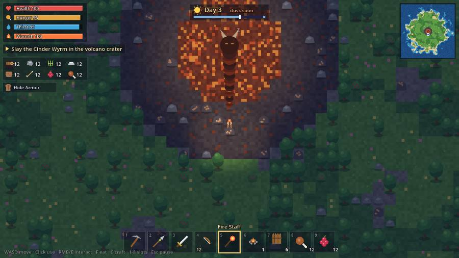
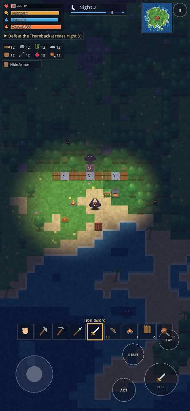

<div align="center">

# 🔥 Isle of Embers 🌋

**Stranded on a volcanic island. Gather, craft and build by day. Survive the raids by night. Light the signal beacon and escape.**

[](https://jaigod.github.io/isle-of-embers/play/)

[](https://jaigod.github.io/isle-of-embers/)
[](https://godotengine.org/)
[](scripts/)
[](https://github.com/JaiGod/isle-of-embers/actions/workflows/pages.yml)
[](LICENSE)

</div>

<table>
<tr>
<td width="50%"><br><sub><b>Title</b>: the menu floats over a live, procedurally generated island</sub></td>
<td width="50%"><br><sub><b>Night raid</b>: campfires light the dark while walls hold back ashlings and brutes</sub></td>
</tr>
<tr>
<td width="50%"><br><sub><b>Boss 1</b>: dodge the Thornback's charge, then hit it while it's stunned</sub></td>
<td width="50%"><br><sub><b>Crafting</b>: 19 recipes across Hands, Workbench, Furnace and Campfire tiers</sub></td>
</tr>
<tr>
<td width="50%"><br><sub><b>Boss 2</b>: the Cinder Wyrm guards the crater and the Ember Heart</sub></td>
<td width="50%" align="center"><br><sub><b>Phone</b>: virtual stick, USE / ACT / EAT / CRAFT buttons, tappable hotbar</sub></td>
</tr>
</table>

## ✨ Features

| | |
|---|---|
| 🏝️ **Procedural island** | Every new game builds a fresh 128×128 island from noise: beaches, meadows, forests, rocky highlands and a smoking volcano in the middle. |
| 🍖 **Real survival** | Health, Hunger, Thirst and Warmth. Drink at the shore, eat berries or roast meat, and huddle by a campfire when the cold night comes. |
| 🪓 **Gathering** | Trees, palms, boulders, berry bushes and iron veins. Better tools gather faster; iron needs a pickaxe. Resources slowly regrow each dawn. |
| 🛠️ **Tiered crafting** | Stone Axe → Pickaxe → Spear / Bow → Iron Sword → Fire Staff, plus Hide and Iron armor. Recipes unlock near a Workbench, Furnace or Campfire. |
| 🧱 **Base building** | Campfire, workbench, wood and stone walls, chest, furnace, farm plot and the Signal Beacon, placed on a tile grid with a live preview. |
| 🌙 **Day/night raids** | A 4-minute day cycle. At night ashlings and gloom brutes swarm in, chew through walls, and burn away at sunrise. |
| 👹 **Two bosses** | The **Thornback** (night 3) charges and stuns itself on obstacles. The **Cinder Wyrm** sleeps in the crater, spits fire volleys, summons ashlings and enrages at half health. |
| 🚢 **A real ending** | Build the Signal Beacon with the Wyrm's Ember Heart, light it, and survive a final 60-second siege until the rescue ship arrives. |
| 🎨 **100% code-drawn** | No image or audio files. Terrain is generated pixel by pixel, every sprite is drawn with `draw_*` calls, and every sound is synthesised into PCM at startup. |
| 📱 **Desktop + touch** | Keyboard and mouse, or a virtual stick and buttons on phones. Portrait and landscape layouts. |
| 💾 **Saves** | Autosaves every minute and at dawn to `user://` (IndexedDB in the browser). Best day and rescue count are kept too. |

## 🎮 Controls

| Action | Keyboard / mouse | Touch |
|---|---|---|
| Move | `W A S D` / arrows | Left virtual stick |
| Use tool, attack, place building | Left click (aim with the mouse), `Space` | **USE** (auto-aims) |
| Interact: drink, chest, farm, cook, beacon | `E` / right click | **ACT** |
| Eat | `F` | **EAT** |
| Crafting menu | `C` / `Tab` | **CRAFT** |
| Hotbar | `1`–`9`, mouse wheel | Tap a slot |
| Pause / Sound | `Esc` / `M` | **II** button |

## 🗺️ How to win

1. Punch trees and boulders. Craft a **Stone Axe** and **Stone Pickaxe** (`C`).
2. Place a **Workbench** and a **Campfire** before the first night.
3. Wall in your camp, mine iron ore and smelt it at a **Furnace**.
4. Defeat the **Thornback** on night 3 and forge a **Fire Staff** from its Ember Shard.
5. Walk into the volcano crater, wake the **Cinder Wyrm** and take its **Ember Heart**.
6. Craft and place the **Signal Beacon**, light it with `E`, and survive 60 seconds.

The HUD always shows your next goal under the survival bars.

## 🧰 Tech stack

- **[Godot 4.3](https://godotengine.org/)**, GDScript only, **Compatibility (WebGL 2) renderer**
- Web export with **threads disabled**, so it runs on GitHub Pages without special headers
- **GitHub Actions** with [`barichello/godot-ci:4.3`](https://github.com/abarichello/godot-ci): headless smoke test → Web export → [GitHub Pages](https://jaigod.github.io/isle-of-embers/)
- Night lighting is a small canvas shader that takes up to 24 light sources (player, campfires, furnaces, fireballs, the crater, the beacon)

## 📁 Project structure

```
isle-of-embers/
├── project.godot            # Godot 4.3 config (gl_compatibility)
├── main.tscn                # One node; everything else is built in code
├── export_presets.cfg       # Web preset (threads off)
├── scripts/
│   ├── data.gd              # Items, recipes, resources, creatures, tips
│   ├── world.gd             # Island generation, collision, y-sorted renderer
│   ├── game.gd              # Game state, survival sim, combat, AI, bosses, saves, input
│   ├── hud.gd               # Bars, clock, minimap, hotbar, boss bar, touch controls
│   ├── ui.gd                # Title, how-to, pause, crafting, chest, win/lose menus
│   ├── art.gd               # Code-drawn item icons and building sprites
│   └── sfx.gd               # Procedural sound effects (AudioStreamWAV)
├── tests/smoke.gd           # Headless playthrough test used by CI
├── web/index.html           # Landing page (animated canvas hero)
├── docs/screenshots/        # README images
└── .github/workflows/pages.yml
```

Quick links: [`scripts/`](scripts/) · [`game.gd`](scripts/game.gd) · [`world.gd`](scripts/world.gd) · [`tests/smoke.gd`](tests/smoke.gd) · [`web/index.html`](web/index.html) · [workflow](.github/workflows/pages.yml) · [Actions runs](https://github.com/JaiGod/isle-of-embers/actions)

## 🖥️ Run locally

```bash
git clone https://github.com/JaiGod/isle-of-embers.git
cd isle-of-embers
# open in the Godot 4.3 editor and press F5, or:
godot --path .
# headless smoke test (the same one CI runs)
godot --headless --path . --script tests/smoke.gd
# web build
godot --headless --path . --export-release "Web" build/play/index.html
python3 -m http.server 8000 --directory build   # then open http://localhost:8000/play/
```

Showcase scenes for screenshots: `play/?demo=1` (base at night), `?demo=2` (Thornback), `?demo=3` (Wyrm crater).

## 📓 Development log

**Design goals.** I wanted a survival game with a clear ending instead of an endless sandbox, so the whole progression points at one goal: the beacon. Each tier unlocks the next. The axe and pickaxe lead to the workbench, the workbench to the furnace and iron, and iron plus the boss drops lead to the beacon. A goal line on the HUD always tells you the next step, so new players never get lost.

**Everything in code.** The rule for this project was no imported art or audio. The island texture is built as raw RGB bytes, 4 pixels per tile, with hashed shading, wet-sand foam and wildflowers, then scaled up with nearest filtering for a crisp pixel look. Trees, rocks, creatures, the player and buildings are all `draw_circle` / `draw_colored_polygon` calls. Sounds (chops, hits, the boss roar, the dawn chime) are synthesised from square, triangle and noise waves into `AudioStreamWAV` buffers at startup.

**Rendering many things fast.** Only the tiles on screen are visited each frame, and resources, buildings, creatures and the player are gathered into one list and sorted by their foot position, so you walk behind trees correctly. Even on phones that stays cheap.

**Night lighting.** My first idea used `PointLight2D` nodes, but lights need textures and behave differently across renderers. Instead, a single full-screen `ColorRect` runs a shader with a uniform array of up to 24 lights in screen space. Darkness fades in at dusk and out at dawn, and campfires, furnaces, fireballs and the lit beacon punch warm holes in it.

**Bosses.** The Thornback is a state machine (walk → windup → charge → stun). Charging into a tree or wall stuns it and doubles your damage, which rewards fighting near your walls. The Cinder Wyrm orbits the crater with a 10-segment body that follows the head, and cycles through fire spreads, ashling summons and, below half health, a 14-way fire ring.

**Challenges and fixes.**
- *Spawning in a lagoon.* Some seeds put a shallow lagoon behind the south beach, and the first version dropped the player into deep water. Spawn search now walks inland until it finds real grass.
- *Hotbar overflow.* A fixed 8-slot hotbar filled up once you owned tools, buildings and food, so new items like the Fire Staff never appeared. The hotbar is now built from everything you own, in a stable order, and scrolls around the selected item.
- *Touch vs. mouse.* Godot emulates mouse clicks from taps, which made every tap swing your weapon. Gameplay now ignores emulated mouse events (`device == -1`) and handles multitouch directly, while menus still get taps as clicks.
- *Phones in portrait.* With a fixed 1280×720 base, portrait phones shrank everything to unreadable sizes. The game swaps to a 720×1280 base in portrait, and the HUD lays itself out from the live viewport size.
- *Typed GDScript.* Godot 4 can't infer types from dictionary lookups (`var x := dict.value` fails), so those values are typed explicitly.
- *CI as a test player.* `tests/smoke.gd` plays the whole game headless: move, chop, craft every tier, place buildings, survive a raid, beat both bosses, save and reload, light the beacon, win, die and restart. CI refuses to deploy if any step fails.
- *Screenshots from the real build.* The images above were captured from the live GitHub Pages build (the `?demo=1/2/3` showcase scenes), not from mock-ups.

**Beta tested on the live site ✅ (2026-11-05).** On https://jaigod.github.io/isle-of-embers/play/ the game boots past the loading bar to the title screen, New Game starts on a fresh island, WASD movement and gathering work, the crafting menu (C) and pause menu (Esc) open and close, Save Game reports "Saved!", and the Thornback demo fight (fire staff, stun message) plays correctly. No game errors in the browser console.

**Ideas for later.** Boats to explore sea stacks, more biomes, a weather system and Android export.

## 🔗 More from JaiGod

- 🏢 [JaiGod on GitHub](https://github.com/JaiGod): all of the studio's games
- 🗡️ [The Hollow Between](https://github.com/JaiGod/the-hollow-between): story RPG made in Godot 4
- ☁️ [Cloud Climb 3D](https://github.com/JaiGod/cloud-climb-3d): low-poly sky obby made in Godot 4
- 🏎️ [Neon Drift 3D](https://github.com/JaiGod/neon-drift-3d): neon arcade racer

## 📄 License

[MIT](LICENSE) © 2026 Jaineil Rana

---

<div align="center">Made by Jaineil Rana (JaKing) · part of <a href="https://github.com/JaiGod">JaiGod</a></div>
